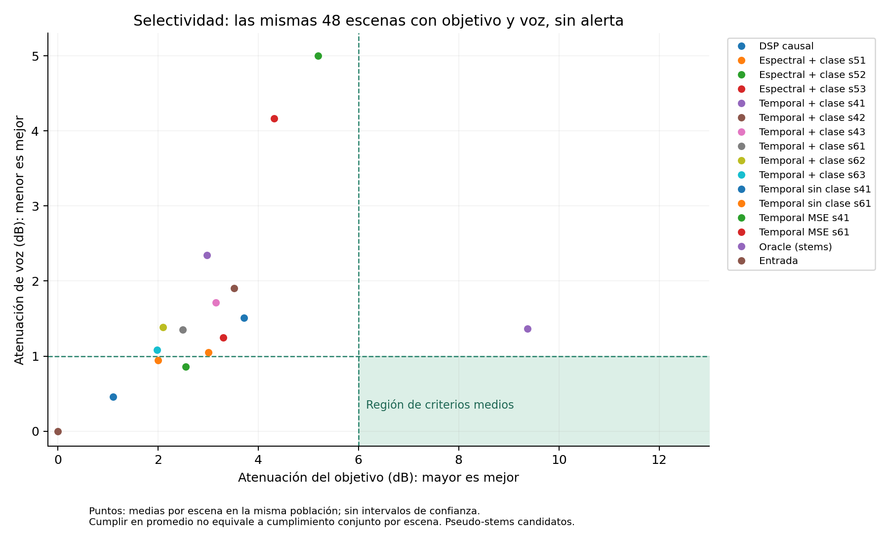
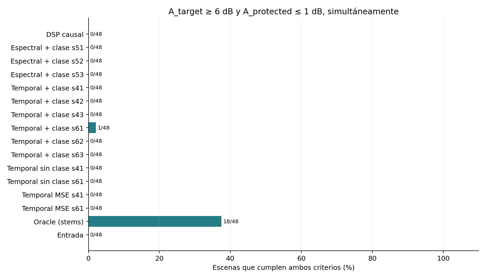

# M4 científico: resultado REWORK

La CNN causal se implementó y entrenó con grabaciones reales, pero **no satisface
la atenuación selectiva exigida**. El candidato elegido únicamente con validación
es `seed61`: en test alcanza una mediana de atenuación del objetivo de
**2.529 dB** frente al criterio de **6 dB**, y una mediana de pérdida de voz de
**1.127 dB** frente al límite de **1 dB**. Cumple ambos límites en **1 de 48**
escenas elegibles. No se declara GO científico y no se inicia P2 streaming.

## Modelo y protocolo preservados

El commit `0a47015426617cebbc2ce8ee24af0c77f9267745` publicó el freeze, los pesos,
la selección por validación, los manifiestos y el evaluador antes de abrir test.
No se reentrenó ni seleccionó de nuevo después de observar esos resultados.

- CNN temporal causal: 217 937 parámetros, campo receptivo de 31 frames,
  embedding de clase de 24 dimensiones y dilataciones 1, 2, 4 y 8.
- Audio mono a 16 kHz; NFFT 512, hop 160, frontend anclado al pasado,
  compresión fija y reconstrucción WOLA. No hay normalización temporal de clip.
- Entrenamiento con AdamW, parada temprana y validación fija. Tres candidatos
  de cobertura completa: semillas 61, 62 y 63; controles MSE y sin clase.
- SHA-256 del candidato seleccionado:
  `c0b34027fe1d4165b062f4145ca7173b3d547cedc39846e17298295e99fb1966`.
- SHA-256 del evaluador congelado:
  `b0585b34d007e335966fc8e4817fff7ddbde50dc5613b084abe8659ec100d436`.

La inferencia aprende de mezcla y clase solicitada. Las referencias separadas se
usan para construir entrenamiento y medir resultados; no son entradas del CNN
en inferencia. Oracle IRM recibe referencias privilegiadas y se identifica como
tal. La política BLOCK evita invocar M4 antes de cargar los pesos en la CLI.

## Corpus y población de evaluación

Se adquirieron 352 archivos: 240 de seis categorías ESC-50 y 112 clips de habla
Mini LibriSpeech. ESC-50 se fijó a una revisión concreta y se particionó por
grabación original; el habla se separó por identidad de hablante. Los audios
ambientales son **pseudo-stems pendientes de revisión humana**, no fuentes cuyo
aislamiento esté certificado. El corpus no se distribuye en este repositorio.

El diseño factorial V2 cubre 32 combinaciones de clase solicitada, presencia de
objetivo, otro ruido, habla y alerta. Contiene 1600 escenas train, 160 val y 160
test. Test contiene 152 mezclas de grabaciones reales y 8 controles de silencio;
hay 153 hashes de mezcla distintos. Las mezclas comparten 13 grupos de fuente
objetivo y 5 hablantes: **160 escenas no son 160 grabaciones independientes**.

Las 48 escenas elegibles tienen objetivo y habla, sin alerta anotada. El criterio
se aplica simultáneamente por escena: A_target ≥ 6 dB y A_protected ≤ 1 dB.
No se inventa un porcentaje global de aprobación. Las medianas siguientes usan
esa misma población; no mezclan subconjuntos distintos para los dos ejes.

| Método | Mediana objetivo (dB) | Mediana pérdida de voz (dB) | Cumplen ambos |
|---|---:|---:|---:|
| Entrada sin procesar | ≈0 | ≈0 | 0/48 |
| DSP causal | 0.972 | 0.351 | 0/48 |
| CNN seleccionada, seed61 | 2.529 | 1.127 | 1/48 |
| CNN seed62 | 2.135 | 1.345 | 0/48 |
| CNN seed63 | 1.905 | 0.882 | 0/48 |
| Control MSE, seed61 | 4.030 | 3.769 | 0/48 |
| Control sin clase, seed61 | 1.917 | 0.884 | 0/48 |
| CNN seleccionada + gate M2 | ≈0 | ≈0 | 0/48 |
| Oracle IRM con referencias privilegiadas | 9.748 | 1.167 | 18/48 |





Los modelos de desarrollo anteriores también se compararon en este mismo test.
Se conservan sus contratos de entrenamiento distintos. Dos variantes espectrales
fueron detenidas al descubrirse omisiones de cobertura V1; sus checkpoints no se
presentan como repeticiones completas. El modelo histórico `drilling_synthetic`
se excluye por taxonomía incompatible, sin inventar equivalencias de clase.

## Condicionamiento semántico e integración M2

El efecto de usar la clase correcta frente a intercambiarla en seed61 es
**+0.623 dB** de atenuación objetivo media por grupo, IC 95 %
**[−0.389, 1.653]**, sobre 13 grupos y 64 escenas activas con objetivo.
El intervalo incluye cero: no se demuestra una mejora semántica robusta.
Una respuesta distinta del embedding no basta para acreditar extracción de clase.

M2 es multietiqueta y offline; sus umbrales se calibraron solo en validación.
En test obtiene macro-F1 **0.663** para estas cuatro etiquetas:

| Etiqueta | TP | FP | FN | Precisión | Recall | F1 |
|---|---:|---:|---:|---:|---:|---:|
| Aspiradora | 53 | 40 | 27 | 0.570 | 0.663 | 0.613 |
| Motosierra | 61 | 25 | 19 | 0.709 | 0.763 | 0.735 |
| Habla | 119 | 24 | 1 | 0.832 | 0.992 | 0.905 |
| Alerta | 32 | 96 | 0 | 0.250 | 1.000 | 0.400 |

El gate estima alerta en 128/160 escenas: 32 verdaderos positivos y 96 falsos
positivos. Ese bloqueo excesivo explica que la integración conserve el audio y
apenas atenúe el objetivo. El recall de alerta observado no acredita una garantía
general de protección. No es una comparación directa con el antiguo benchmark
UrbanSound de diez clases ni una validación de reconocimiento en streaming.

## Integridad, reproducción y limitaciones de la evidencia

La primera evaluación terminó en la sesión anterior. Antes de publicar sus CSV,
el entorno temporal fue reemplazado y sus resultados brutos dejaron de estar
disponibles. **No se reconstruyen esos archivos a partir de cifras recordadas.**
Se reproduce el cálculo con los mismos pesos, recetas, código y versiones,
preservados previamente en Git. Esta reproducción se identifica explícitamente
como test **ya observado**, nunca como un segundo test independiente.

El freeze original permanece intacto. `freeze_replication.json` es una copia de
sus bytes en la misma carpeta, con recibo de intento propio. El script de
reproducción no contiene entrenamiento ni selección. Los 352 contenedores PCM
se restauran y verifican contra sus SHA-256 archivados; sus metadatos originales
no sustituyen las fechas reales de la reproducción.

La reproducción conserva el cumplimiento 1/48 y ambas medianas a la precisión
mostrada en este informe. Las diferencias respecto de los valores conservados
en el contexto de la primera sesión son menores de 0.000001 dB. Esto no demuestra
identidad fila por fila con el CSV perdido; los resultados brutos disponibles
son los de esta reproducción.

- [Resultados brutos de reproducción y recibo de hashes](../05_evidence/m4_sci_real_2026-10-27/test_replication/)
- [Procedencia y fechas de la reproducción](../05_evidence/m4_sci_real_2026-10-27/replication_receipt.json)
- [Freeze original publicado antes de test](../05_evidence/m4_sci_real_2026-10-27/freeze_test.json)
- [Selección exclusiva de validación](../04_build/selective_audio_lab/models/m4_sci_real_candidate_v1/selection.json)
- [Script de reproducción](../04_build/selective_audio_lab/experiments/reproduce_m4_frozen_run.py)

Las pruebas de software y los hashes verifican la implementación, no convierten
estos resultados acústicos en aprobación científica. Permanecen pendientes la
revisión auditiva de pseudo-stems, duplicados perceptuales/recortados, suficiencia
de fuentes por clase y evaluación de campo independiente. El habla es lectura en
inglés; no se atribuye validación en español ni eficacia clínica en TEA.
Los intervalos por grupo tampoco resuelven toda la dependencia cruzada entre
hablantes y fuentes. La ejecución CPU no demuestra rendimiento en el Acer.

En el entorno reconstruido pasaron **29 pruebas científicas** y la regresión
completa terminó con **136 aprobadas, 2 omitidas y 4 advertencias**. Las omisiones
son dos pruebas de auditoría histórica que requieren un `paired.csv` local no
versionado. Se conservan los logs nuevos junto a los anteriores, sin sustituirlos.

La CLI real sobre `test-00010` reproduce la salida del candidato del evaluador
con error máximo absoluto **0.0**. Con protección explícita y una ruta de pesos
inexistente, devuelve las mismas muestras de entrada y `model_called=false`.
El recibo `cli_smoke.json` conserva ambas verificaciones. No es una prueba de
streaming ni de detección automática de todas las alertas.

Para repetir este cálculo desde `04_build/selective_audio_lab`, en un entorno
con `requirements-scientific.txt`, elegir un identificador nuevo de reproducción:

```bash
OPENBLAS_NUM_THREADS=1 OMP_NUM_THREADS=4 python experiments/reproduce_m4_frozen_run.py --tag mi-reproduccion-1
```

El script rechaza registros, freezes de reproducción o salidas preexistentes;
no borra resultados para permitir nuevos intentos silenciosos.

## Trabajo necesario antes de P2

La siguiente iteración debe mejorar la separación entre objetivo y voz con
fuentes revisadas y más grabaciones independientes, y corregir la calibración
multietiqueta. Toda decisión posterior a estos resultados es desarrollo sobre
un test expuesto y necesita un **nuevo test reservado** para su confirmación.
No se aflojan los umbrales ni se ajustan al test existente.

El frontend causal y las pruebas WOLA no prueban captura en vivo, p95 por hop,
latencia física de extremo a extremo ni Android. P2 permanece pendiente del GO
científico definido en los contratos existentes. El título, los objetivos y los
RNF institucionales no se modificaron.
