# NOTEBOOKLM MASTER CONTEXT — EXAMEN PARCIAL PI8 / T10 / HESYCHIA

> Este documento es la única guía de generación de la presentación. No inventar resultados, no reinterpretar el alcance, no mezclar formulaciones históricas que ya fueron corregidas.

## 0. Identidad del proyecto

- **Universidad:** Universidad Nacional Mayor de San Marcos (UNMSM)
- **Facultad:** Facultad de Ingeniería de Sistemas e Informática
- **Curso:** Proyecto de Tesis II
- **Grupo:** G6
- **Tesista:** Eduardo Farid Merino Córdova
- **Código:** T10
- **Grupo de aporte:** Grupo B — aporte práctico
- **Asesor:** Daniel Alfonso Quinto Pazce
- **Título institucional exacto:**  
  **Diseño de un sistema inteligente de cancelación selectiva de ruido mediante aprendizaje profundo para la atenuación de estímulos acústicos asociados a la hiperacusia en personas con TEA**
- **Artefacto real:** prototipo técnico Edge AI de procesamiento y atenuación selectiva de audio.
- **Etapa:** Semana 8 / Examen Parcial.

## 1. Fuente de verdad y reglas innegociables

Precedencia:
1. PI7 v1.1 corregido e integrado PI6 + PI7.
2. Correcciones formales PI6/PI7.
3. PI5 requisitos y escenarios.
4. Tesis I solo como antecedente cuando no contradice lo anterior.

Reglas:
- “Cancelación” del título **no significa ANC físico**. La implementación vigente es atenuación selectiva mediante máscara/ganancia tiempo–frecuencia.
- M2 = reconocimiento semántico. M4 = separación/atenuación. **No son el mismo problema.**
- M2 **no decide automáticamente** qué se atenúa.
- Target se fija por configuración experimental.
- M3a = mezclas offline.
- M3b = política runtime.
- M5 = orquestador.
- UrbanSound8K = benchmark/eventos.
- LibriSpeech = señal protegida.
- ESC-50 = robustez opcional.
- Android = perfilado TFLite; no streaming Android completo en esta fase.
- No hacer afirmaciones clínicas, diagnósticas ni de eficacia terapéutica.
- Si una métrica no alcanza su umbral, se reporta como incumplida. Nunca mover el criterio después de observar el resultado.
- La UI no debe mostrar métricas ilustrativas como si fueran resultados reales.
- La baseline PI8 usa IRM oracle con stems conocidos. **No es el estimador CNN final.**

## 2. Arquitectura contractual

### 2.1 Vista general

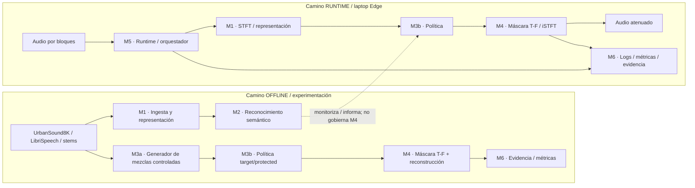

### 2.2 Política protected

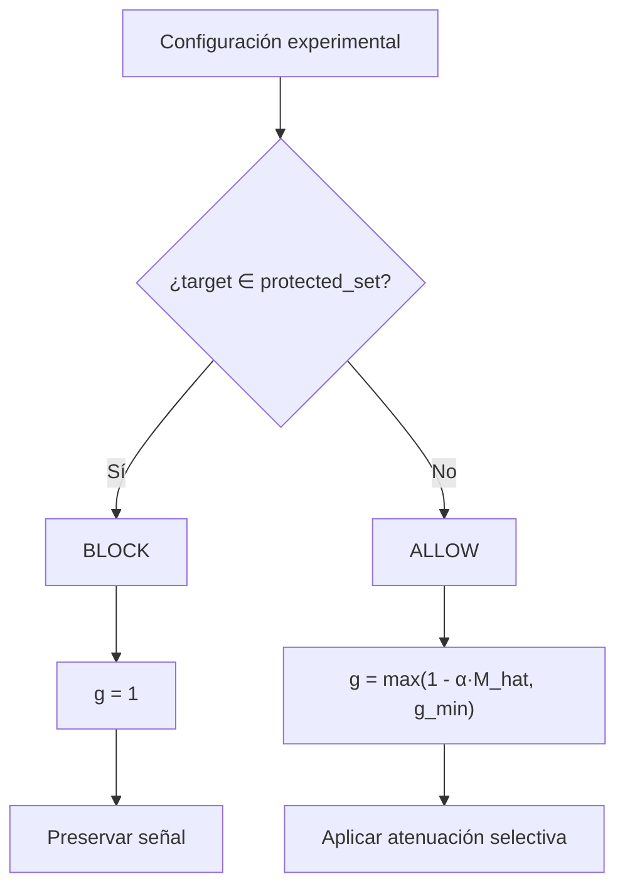

## 3. Modelo de datos contractual

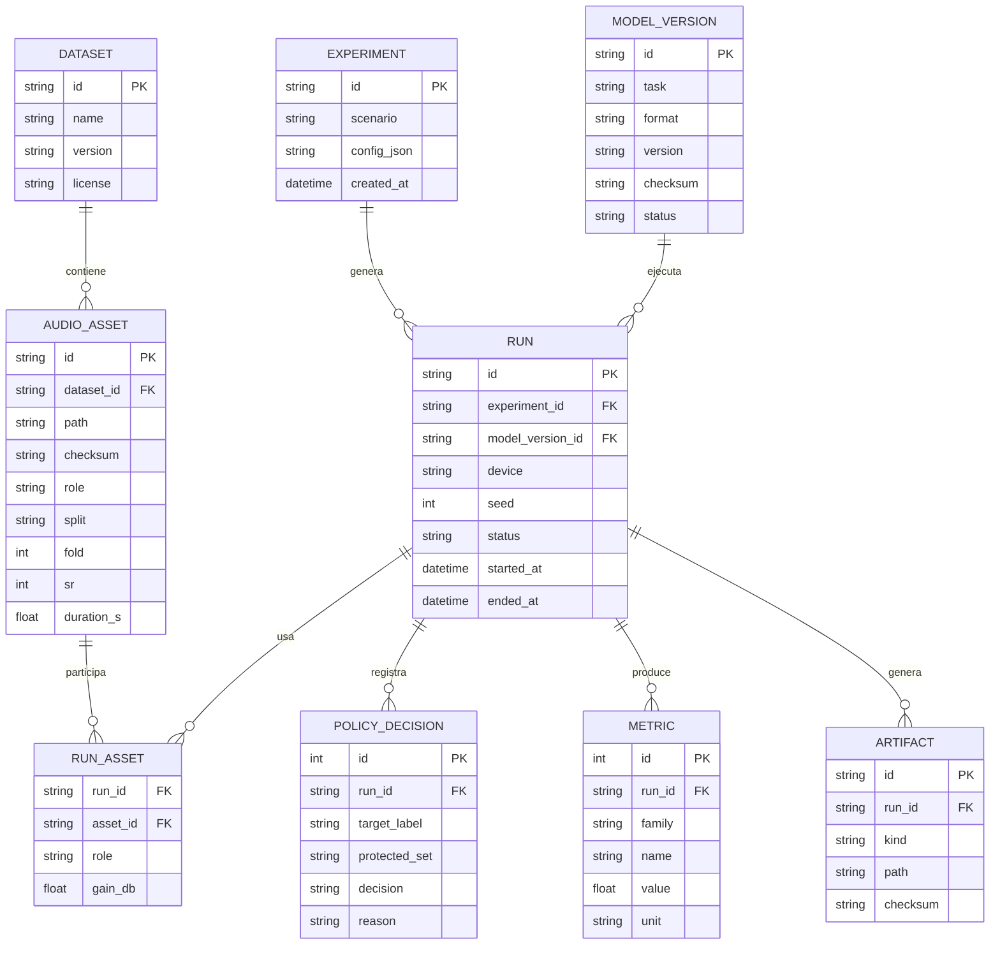

## 4. Secuencia crítica de ejecución

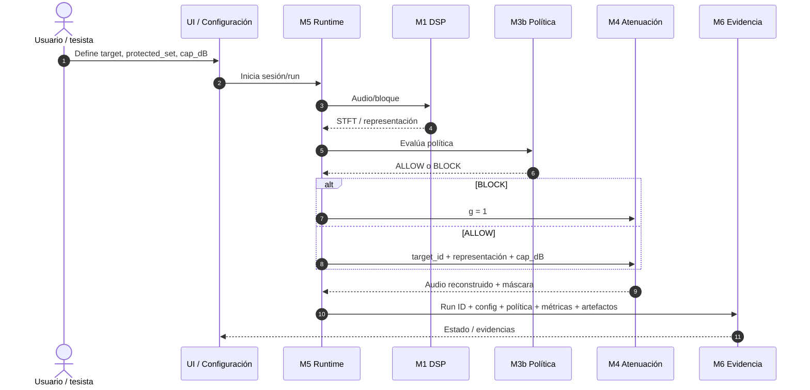

## 5. Contrato API / jobs

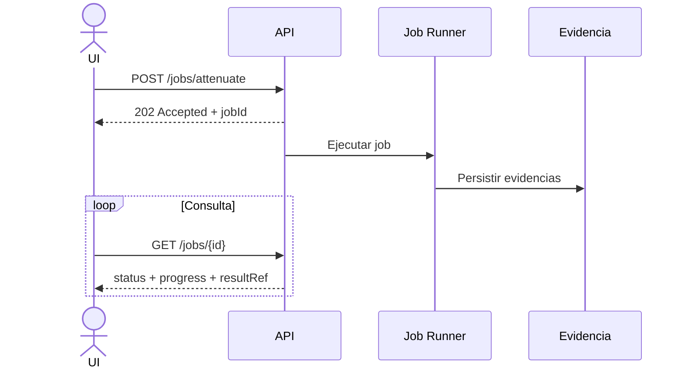

Endpoints que deben aparecer en la diapositiva 7:
- POST /jobs/benchmark → 202 {jobId}
- POST /jobs/train-mask → 202 {jobId}
- POST /jobs/attenuate → 202 {jobId}
- POST /jobs/export-tflite → 202 {jobId}
- GET /jobs/{id} → status/progress/resultRef
- POST /streaming/session → 201 {sessionId}

Android no depende de esta API para inferencia: TFLite local y profile.json como evidencia.

## 6. M2 — benchmark UrbanSound8K

Estado: software implementado y probado con fixture; **resultado científico real pendiente** hasta ejecutar la distribución completa.

Contrato:
- 8,732 clips.
- 10 clases.
- clips de hasta 4 s.
- folds oficiales 1–10.
- Train = folds 1–8.
- Validación = fold 9.
- Test final = fold 10.
- Verificar que fsID no cruce particiones.
- 16 kHz mono.
- n_fft = 512.
- hop = 160.
- MFCC = 20.
- log-Mel = 64.
- baselines: SVM RBF y Random Forest.
- selección del candidato solo con fold 9.
- fold 10 se abre después de selección.
- métricas: Macro-F1, Macro-Recall, Macro-Precision, Accuracy, matriz de confusión.
- RNF-03: Macro-F1 test ≥ 0.85.

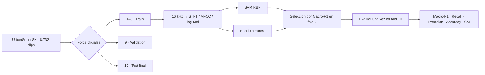

No colocar un valor de Macro-F1 real hasta tener `semantic_summary.json` producido por el dataset completo.

## 7. M4 — diseño aprendido final

El PI8 actual solo valida el camino de inferencia con IRM oracle.

Diseño final:
- Entrada |X|: [B,T,257].
- target_id → embedding 16.
- 3 bloques Conv1D causales.
- 128 canales.
- kernel = 3.
- dilaciones 1,2,4.
- ReLU.
- Dense 257 + sigmoid.
- sin look-ahead.
- IRM objetivo = |S_target|/(|S_target|+|S_rest|+eps).
- loss = 0.5·MAE(mask) + 0.5·MAE(magnitud objetivo normalizada).
- g_min = 10^(-cap_db/20).
- BLOCK → g=1.
- ALLOW → g=max(1-α·M_hat,g_min).
- Y=g·X.

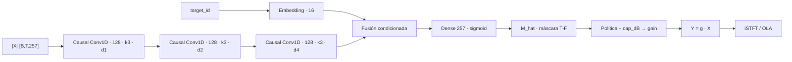

## 8. Métricas y criterios congelados

### Semántica
- Macro-F1 ≥ 0.85 en test predefinido.

### Acústica
- A_target ≥ 6 dB.
- A_protected ≤ 1 dB.
- SI-SDRi(protected) > 0 dB.

### Compute
- laptop camino crítico por hop: p95 ≤ 10 ms.
- laptop E2E: p95 ≤ 60 ms.
- Android TFLite inference: p95 ≤ 20 ms.
- TFLite ≤ 10 MB.
- Android RAM pico ≤ 256 MB.
- estabilidad laptop 10 min sin fallo incontrolado; drop/underrun < 1 %.
- paridad TFLite float32 mask MAE ≤ 0.01 vs TensorFlow.
- quantization: degradación Macro-F1 no > 0.02.

## 9. Evidencia PI8+ que sí existe

Run de referencia `PI8-DEMO-RUN-001`:
- A_target = 11.994 dB.
- A_protected = 0.00727 dB.
- SI-SDRi(protected) = 11.518 dB.
- 4 s @ 16 kHz.
- n_fft = 512.
- hop = 160.
- baseline = oracle_IRM_stem_demo.

Evidencias:
- protected.wav
- target.wav
- background.wav
- mixture.wav
- output_selective.wav
- mask_irm.npy
- gain.npy
- demo_metrics.csv
- demo_summary.json
- artifacts_manifest.csv
- evidence.sqlite
- latency_samples.csv
- latency_summary.json

CI más reciente del incremento modular:
- 6 tests contractuales OK.
- instalación lockfile OK.
- demo OK.
- benchmark local del clip OK.
- validador de SHA-256 + SQLite OK.

Importante: la latencia del clip completo **no** se puede presentar como p95 por hop, E2E o Android.

## 10. Estado real por módulo

No usar porcentajes de avance salvo que exista una metodología formal que los calcule. Para el parcial se utiliza una **tabla categórica verificable**.

| Módulo | Estado verificable | Qué está construido | Qué falta |
|---|---|---|---|
| M1 | PARCIAL | DSP baseline, 16 kHz, STFT | integración completa con datos reales/runtime |
| M2 | SOFTWARE LISTO / EVIDENCIA REAL PENDIENTE | pipeline UrbanSound8K, SVM/RF, folds, métricas, fixture CI | ejecutar dataset oficial completo |
| M3a | BASELINE | stems y mezcla sintética controlada | mezclas con datos reales |
| M3b | IMPLEMENTADO | ALLOW/BLOCK, protected precedence, persistencia | — |
| M4 | BASELINE | IRM oracle + gain + iSTFT | entrenar estimador aprendido |
| M5 | PARCIAL | web console Docker + procesamiento local de clip | streaming por bloques + E2E + Android |
| M6 | IMPLEMENTADO | SQLite, Run ID, métricas, artefactos, SHA-256, validator | integrar evidencias finales M2/M4/TFLite |

**Visual correcto para esta información: tabla de estados, no gráfica porcentual.**

## 11. Trazabilidad

| OE | Requisito | Componente | Diseño | Evidencia actual |
|---|---|---|---|---|
| OE1 | RF-01/02 | M1 | A1 | audio_core.py / 16 kHz / STFT |
| OE1 | RF-03 | M2 | A2 | semantic_benchmark.py + validator + fixture CI; evidencia real pendiente |
| OE2 | RF-04 | M3b | A4 | policy.py + ALLOW/BLOCK + POLICY_DECISION |
| OE2 | RF-05 | M3a | A3 | stems + mezcla + checksums |
| OE2 | RF-06 | M4 | A5-infer | IRM oracle + gain |
| OE2 | RF-07 | M4 | A6 | output_selective.wav / iSTFT |
| OE3 | RF-08 | M5 | A7 | latency_samples/summary; streaming pendiente |
| OE1–OE3 | RF-09 | M6 | A9 | evidence.sqlite + JSON/CSV + SHA-256 |
| OE2 | RF-10 | M4 | A5-train | pendiente |
| OE3 | RF-11 | M5 | A8 | TFLite/paridad pendiente |

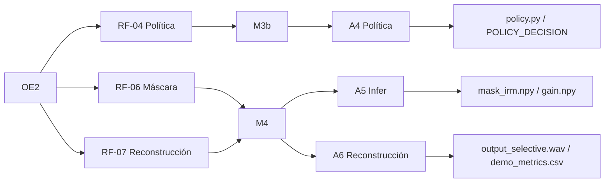

## 12. Plan S9–S15

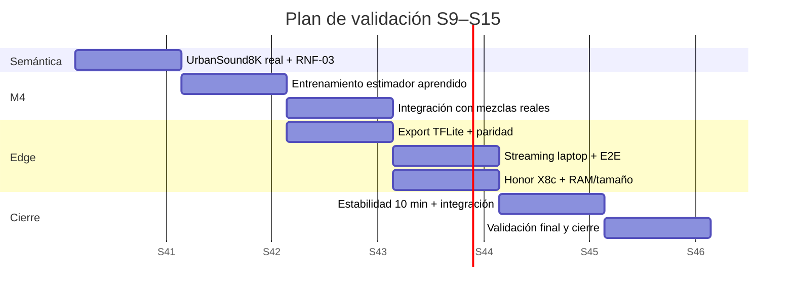

Si NotebookLM no interpreta fechas del Gantt por semana, representarlo como S9 → S10 → S11 → S12 → S13 → S14 → S15, sin inventar días.

## 13. Riesgos

| Riesgo | Impacto | Mitigación |
|---|---|---|
| Confundir baseline oracle con modelo final | invalida interpretación científica | rotular siempre “baseline/oracle”; M4 aprendido separado |
| Confundir latencia de clip con p95/hop/E2E/Android | claim falso | reportar alcance de cada medición en la misma diapositiva |
| M2/M4 no alcanzan umbral | hipótesis parcial/no confirmada | reportar resultado; no cambiar umbral post hoc |
| Degradar señal protegida | afecta objetivo de selectividad | protected precedence + A_protected + SI-SDRi |
| Perfil Android insuficiente | RNF compute no alcanzado | optimizar TFLite o reportar incumplimiento |

## 14. Diseño visual de la PPT

### Formato
- 16:9.
- Fondo blanco o gris muy claro.
- Estética académica/ingeniería, sobria, moderna, no “AI neon”.
- Máximo 12 slides.
- Tipografía legible: título 28–32 pt, subtítulo 22–24 pt, cuerpo 18–20 pt, etiquetas de diagramas ≥16 pt.
- Margen seguro: 6 % izquierda/derecha, 5 % arriba, 6 % abajo.
- Nada crítico a menos de 0.45 in del borde.
- Una idea principal por slide.
- Evitar párrafos. Máximo 3–5 bullets cortos cuando haya texto.
- Usar etiquetas visuales: **IMPLEMENTADO**, **BASELINE**, **PENDIENTE**.
- No usar iconografía decorativa sin función.
- Evitar capturas de terminal como elemento principal salvo en la demo.

### Paleta sugerida
- Bordó UNMSM oscuro como acento institucional.
- Azul oscuro/gris para arquitectura y texto técnico.
- Verde únicamente para “implementado/cumple”.
- Ámbar para “baseline/parcial”.
- Gris para “pendiente”.
- Rojo solo para riesgo o incumplimiento.

### Espaciado
- Título: 0.45–0.55 in desde borde superior.
- Área de contenido: iniciar 0.2–0.3 in debajo del título.
- Separación entre bloques: 0.22–0.30 in.
- Tablas: máximo 5–6 filas visibles por slide; usar abreviación RF/RNF con leyenda.
- Diagramas: ocupar 55–70 % del área útil cuando sean el mensaje principal.

### Regla de evidencia
Cada slide de S8 debe mostrar una pequeña etiqueta:
- **Medido**: dato producido por run/CI.
- **Implementado**: existe código/test.
- **Pendiente**: contrato congelado sin medición.
Nunca usar “validado” para un resultado que solo proviene del fixture sintético.

## 15. Blueprint exacto de las 12 diapositivas

### SLIDE 1 — CARÁTULA
**Objetivo:** identidad y continuidad administrativa.

Layout:
- 12 % superior: UNMSM · FISI · Proyecto de Tesis II.
- 55 % centro: título exacto, máximo 4 líneas.
- 20 % inferior izquierdo: Eduardo Farid Merino Córdova · T10 · Grupo B.
- 20 % inferior derecho: Asesor Daniel Alfonso Quinto Pazce.
- Pie: “Examen Parcial · Semana 8 · 2026-II”.

No agregar arquitectura ni métricas aquí.

---

### SLIDE 2 — PROBLEMA Y OBJETIVOS · 1 min
Layout 40/60.

Izquierda:
- Problema en 2–3 líneas.
- Un dato de Tesis I solo si está respaldado por la fuente cargada en NotebookLM.

Derecha:
- OG en una caja principal.
- OE1/OE2/OE3 como tres bloques horizontales.

Visual:
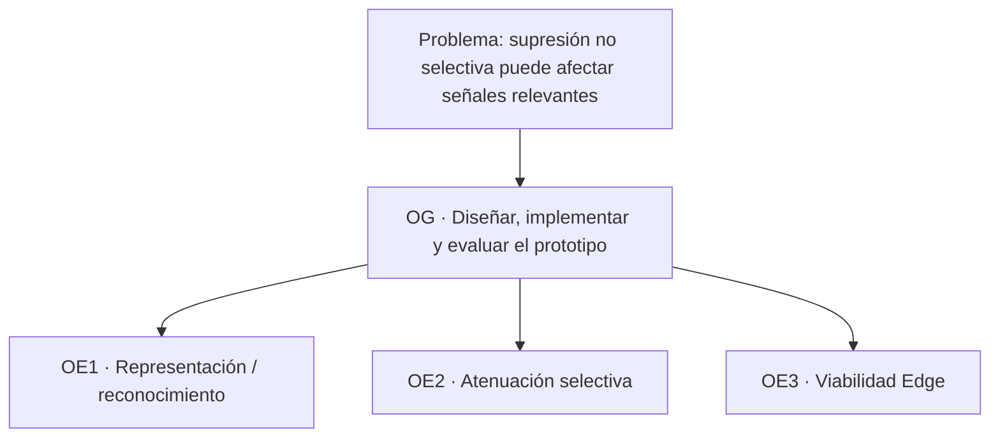

Nota: “recordar de dónde venimos — Tesis I”.

---

### SLIDE 3 — S5 REQUISITOS · 1.5 min
Layout 65/35.

Izquierda: tabla RF Must:
| Req | Descripción compacta | OE | MoSCoW |
|---|---|---|---|
| RF-02 | STFT/log-Mel/MFCC | OE1 | Must |
| RF-03 | benchmark semántico | OE1 | Must |
| RF-04 | target/protected/cap | OE2 | Must |
| RF-06/07 | máscara + reconstrucción | OE2 | Must |
| RF-08/09 | runtime + evidencia | OE3 | Must |
| RF-10/11 | entrenamiento + TFLite | OE2/OE3 | Must |

Derecha: RNF en tarjetas:
- Macro-F1 ≥ 0.85
- A_target ≥ 6 dB
- A_protected ≤ 1 dB
- laptop hop p95 ≤ 10 ms
- E2E p95 ≤ 60 ms
- Android TFLite p95 ≤ 20 ms

Pie: “Umbrales técnicos, no clínicos.”

---

### SLIDE 4 — S6 ARQUITECTURA · 1.5 min
70 % diagrama, 30 % stack.

Usar el Mermaid de arquitectura general de §2.1.

Panel stack:
- Python 3.11
- NumPy / SciPy / librosa
- scikit-learn
- TensorFlow/Keras [previsto para M4 aprendido]
- SQLite
- FastAPI / Streamlit [contrato]
- Kotlin / TFLite [perfilado]
- Git

Marcar visualmente OFFLINE vs RUNTIME.

---

### SLIDE 5 — S6 DECISIONES · 1 min
Tres tarjetas de igual ancho.

1. Edge-first
   - alternativa: cloud obligatorio
   - razón: latencia/privacidad/reproducibilidad.

2. M2 ≠ M4
   - alternativa: clasificación decide bins
   - razón: etiqueta semántica no localiza T-F.

3. Política explícita
   - alternativa: target automático
   - razón: control, seguridad, trazabilidad.

Franja inferior: “M3a offline / M3b runtime”.

---

### SLIDE 6 — S7 DISEÑO DETALLADO 1 · 1.5 min
Grupo B: modelo de datos + secuencia.

Layout 52/48:
- izquierda: ER reducido, solo entidades y relaciones.
- derecha: secuencia crítica.

Usar §3 y §4, simplificando etiquetas para legibilidad.

Callout inferior: “RUN_ASSET resuelve N:M · POLICY_DECISION conserva ALLOW/BLOCK”.

---

### SLIDE 7 — S7 DISEÑO DETALLADO 2 · 1 min
Grupo B: UI + API.

Layout 55/45.

Izquierda: wireframe lógico:
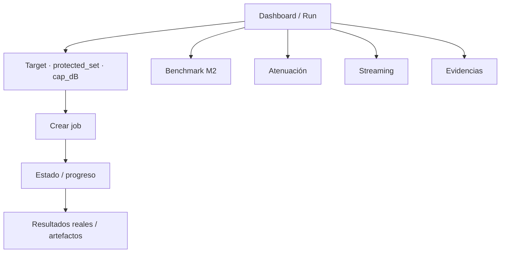

Derecha: endpoints compactos.
Pie rojo/ámbar pequeño: “No mostrar métricas ficticias como reales”.

---

### SLIDE 8 — S8 CONSTRUCCIÓN · 1 min
Layout 60/40.

Izquierda: **tabla categórica**, no usar gráfica ni porcentajes inventados:
| Módulo | Estado |
|---|---|
| M1 | PARCIAL |
| M2 | SOFTWARE LISTO / EVIDENCIA REAL PENDIENTE |
| M3a | BASELINE |
| M3b | IMPLEMENTADO |
| M4 | BASELINE |
| M5 | PARCIAL |
| M6 | IMPLEMENTADO |

Derecha:
- “Funciona ahora”: consola web Docker, M3b, M6, baseline M4, pipeline M2, CI.
- “Falta”: M2 real, M4 aprendido, streaming, TFLite, Honor X8c.
- QR al repositorio.

Pie: “Estados derivados de evidencia del repositorio; no equivalen a porcentajes de éxito científico.”

---

### SLIDE 9 — S8 DEMOSTRACIÓN · 2 min
Esta es la slide más visual.

Arriba 20 %: pipeline:
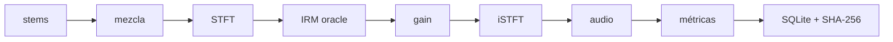

Centro: 3 KPIs grandes:
- A_target = 11.99 dB
- A_protected = 0.007 dB
- SI-SDRi = 11.52 dB

Abajo:
- “6 tests CI · OK”
- “checksums · OK”
- “SQLite · OK”
- latencia del clip completo solo como nota secundaria y rotulada “NO E2E / NO Android”.

Ideal: usar waveform/spectrogram real de la evidencia si NotebookLM lo puede tomar de las fuentes.

---

### SLIDE 10 — MATRIZ DE TRAZABILIDAD · 0.5 min
Usar la tabla de §11, máximo 6 filas visibles, priorizar RF-03,04,06,07,08,09.

Añadir abajo el mini-diagrama OE2 → RF → M → A → evidencia.

Mensaje principal: “Nada construido queda desconectado del objetivo; nada pendiente se presenta como evidencia.”

---

### SLIDE 11 — PLAN DE VALIDACIÓN · 1 min
Layout 60/40.

Izquierda: métricas y umbrales:
- semántica;
- acústica;
- compute;
- reproducibilidad;
- pruebas funcionales/ISO 25010.

Derecha: timeline S9–S15:
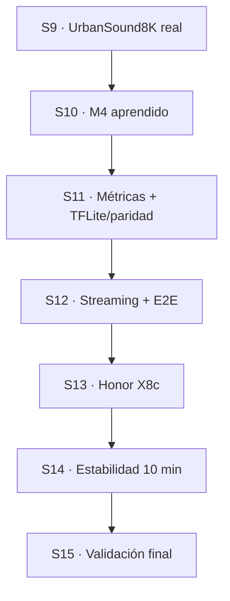

SUS/TAM: no presentarlo como realizado. Si se menciona, poner “aplicabilidad por confirmar con asesor”.

---

### SLIDE 12 — RIESGOS Y PRÓXIMOS PASOS · 0.5 min
Layout 65/35.

Izquierda: 3 riesgos y mitigación:
1. baseline ≠ final → rotulado estricto.
2. latencias distintas → scopes separados.
3. umbral no alcanzado → reportar sin mover meta.

Derecha: observaciones levantadas:
- M2/M4 separados.
- M3a/M3b separados.
- Android acotado.
- jobs 202 + jobId.
- RUN_ASSET / POLICY_DECISION.
- UI sin fake metrics.
- sin claims clínicos.

Callout final grande:
**SIGUIENTE GATE: ejecutar UrbanSound8K completo y congelar evidencia M2.**

## 16. Instrucción final para NotebookLM

Genera una presentación académica de exactamente 12 diapositivas siguiendo el blueprint anterior. No alteres el orden. No agregues slides introductorias ni de “gracias”. Mantén el título institucional exacto. Usa Mermaid como especificación semántica de diagramas; si el motor de slides no renderiza Mermaid, conviértelo a diagramas visuales equivalentes sin cambiar relaciones ni significado.

Prioriza diagramas y tablas sobre párrafos. Mantén el texto oral fuera de la diapositiva. No inventes resultados, usuarios, encuestas, métricas, gráficos ni porcentajes diferentes de los especificados. Distingue visualmente IMPLEMENTADO / BASELINE / PENDIENTE.

La presentación debe ser defendible ante un jurado técnico: cada claim debe corresponder a evidencia real o estar explícitamente marcado como objetivo/pending.
