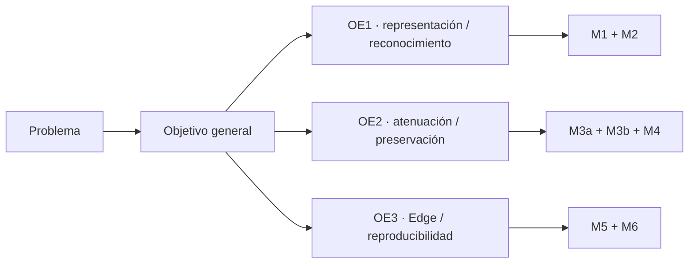

# Propuesta de alineación de objetivos — T10 / HESYCHIA

> **Estado:** PROPUESTA PARA REVISIÓN CON EL ASESOR.  
> No cambia el título institucional registrado ni sustituye por sí sola los objetivos aprobados.

## Motivo

Las formulaciones históricas de Tesis I mezclaban en una misma cadena clasificación semántica, enmascaramiento espectral y una única meta de latencia. PI7 v1.1 ya separa esos problemas en M2, M4 y M5. Para evitar contradicción entre objetivos, requisitos, arquitectura y validación se propone expresar los objetivos de forma operacional.

## Objetivo general propuesto

**Diseñar, implementar y evaluar computacionalmente un prototipo Edge AI de procesamiento selectivo de audio que permita reconocer eventos acústicos, aplicar atenuación selectiva mediante máscaras tiempo–frecuencia condicionadas por un evento objetivo y caracterizar su viabilidad de ejecución local, preservando señales definidas como protegidas.**

## Objetivos específicos propuestos

### OE1 — Representación y reconocimiento

**Comparar representaciones acústicas y modelos de reconocimiento semántico para caracterizar eventos de audio bajo un protocolo reproducible de entrenamiento, validación y prueba.**

Evidencia asociada:
- STFT / log-Mel / MFCC;
- M2;
- UrbanSound8K;
- SVM / Random Forest y candidato posterior;
- Macro-F1, Macro-Recall, Macro-Precision, Accuracy y matriz de confusión.

### OE2 — Atenuación selectiva y preservación

**Diseñar e implementar un mecanismo de atenuación selectiva basado en máscara tiempo–frecuencia condicionada por el evento objetivo, incorporando una política explícita de señales protegidas y evaluando simultáneamente la atenuación del objetivo y la degradación de la señal protegida.**

Evidencia asociada:
- M3a / M3b / M4;
- ALLOW / BLOCK;
- A_target;
- A_protected;
- SI-SDRi(protected);
- audio reconstruido y artefactos del run.

### OE3 — Viabilidad Edge y reproducibilidad

**Caracterizar la viabilidad de ejecución local del prototipo mediante métricas de latencia, recursos, estabilidad y reproducibilidad, diferenciando el procesamiento en laptop del perfilado de inferencia TFLite en el dispositivo móvil.**

Evidencia asociada:
- M5 / M6;
- p50/p95 por alcance de medición;
- E2E laptop cuando exista streaming;
- tamaño/RAM/inferencia TFLite;
- Run ID, SQLite, hashes y manifiestos.

## Trazabilidad conceptual

## Qué NO cambia esta propuesta

- No cambia el título institucional.
- No transforma la tesis en ANC físico.
- No introduce eficacia clínica.
- No convierte M2 en controlador automático de M4.
- No afirma que el modelo aprendido M4, streaming o TFLite ya estén construidos.
- No modifica umbrales después de observar resultados.

## Gate de adopción

Solo incorporar estas formulaciones al documento maestro como objetivos oficiales después de confirmación del asesor. Mientras tanto deben usarse como guía de coherencia interna para no volver a mezclar clasificación, separación y latencia en una sola afirmación.
