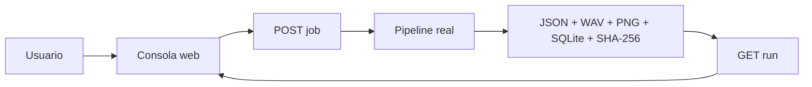

# Especificación de UI de demostración — HESYCHIA T10

## Rol de la UI

La UI no es el aporte científico central ni modifica el contrato del algoritmo. Su función es hacer demostrable el artefacto de Grupo B: configurar un run, ejecutar capacidades realmente implementadas, reproducir audio, visualizar evidencia y consultar el estado de módulos pendientes.

Se evita el patrón del prototipo PI7 antiguo, donde valores ilustrativos estaban embebidos directamente en HTML. La consola PI8+ obtiene los números desde la API del run y no renderiza resultados científicos antes de ejecutarlo.

## Secciones

| Sección | Propósito | Fuente |
|---|---|---|
| Estado | mostrar qué módulos existen y cuáles siguen pendientes | contrato + código |
| Atenuación | ejecutar baseline IRM controlada | `run_demo()` |
| Benchmark M2 | validar/montar UrbanSound8K y ejecutar SVM/RF | `validate_contract()` + `run_benchmark()` |
| Evidencias | consultar runs, política, métricas, artefactos y SHA | JSON/SQLite/manifest |
| Edge readiness | separar criterios objetivo de mediciones aún pendientes | contrato de RNF |

## Principios UX

1. **Evidence-first:** un KPI solo aparece después de recibir un resultado del backend.
2. **Progressive disclosure:** primero estado general; luego ejecución; luego evidencia técnica.
3. **Affordance honesta:** botones de streaming/TFLite quedan deshabilitados o responden 501 mientras no exista implementación.
4. **Error prevention:** target/protected de la baseline sintética están congelados a lo que realmente genera el código.
5. **Traceability:** Run ID, política y SHA-256 visibles desde la misma demo.
6. **Responsive:** la consola puede proyectarse en laptop y seguir siendo utilizable en viewport reducido.
7. **No clinical framing:** el disclaimer permanece visible en navegación.

## Estados visuales

| Estado | Significado |
|---|---|
| IMPLEMENTADO | existe implementación ejecutable y prueba/evidencia correspondiente |
| BASELINE | funciona como incremento técnico, pero no es el diseño final |
| PARCIAL | parte del contrato funciona; faltan obligaciones explícitas |
| SOFTWARE LISTO / EVIDENCIA PENDIENTE | pipeline probado con fixture; falta experimento real |
| PENDIENTE | no existe aún evidencia ejecutada |

No se usan porcentajes de avance porque no hay una metodología cuantitativa formal que los produzca.

## Flujo de demo



## Atenuación

Entrada configurable:
- seed;
- cap_dB;
- alpha.

Entradas congeladas en esta baseline:
- target = `siren_synthetic`;
- protected = `speech_like_synthetic`.

Salida visible solo tras el run:
- A_target;
- A_protected;
- SI-SDRi protected;
- política ALLOW/BLOCK;
- audio mezcla/salida;
- waveform real;
- espectrograma real;
- artefactos y checksums.

## Benchmark M2

El botón permanece deshabilitado si no se detectan:
- `metadata/UrbanSound8K.csv`;
- `audio/fold1`;
- `audio/fold10`.

Después de ejecutar el benchmark real, se muestran únicamente métricas devueltas por `semantic_summary.json`/job:
- modelo seleccionado;
- Macro-F1;
- Macro-Recall;
- Macro-Precision;
- Accuracy;
- cumplimiento/no cumplimiento de RNF-03.

## Docker

La UI y el backend se empaquetan juntos. El host no necesita instalar Python ni las dependencias de audio; solo Docker y, para M2 real, el dataset montado en modo read-only.

Comando:

```powershell
docker compose up --build
```

URL:

`http://localhost:8080`